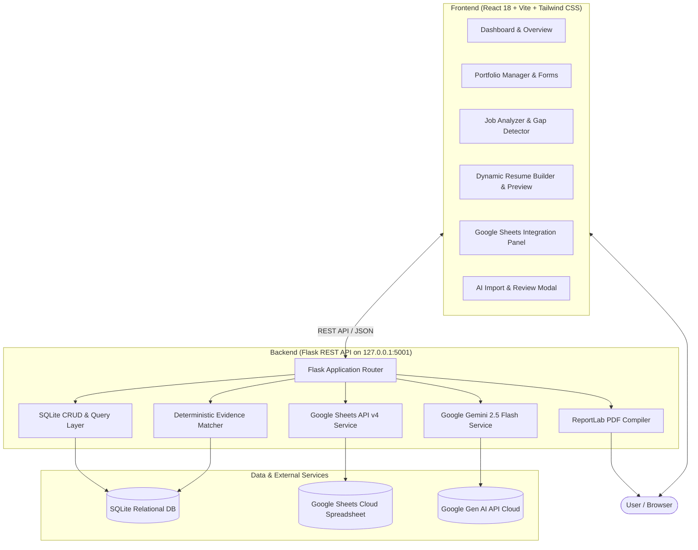
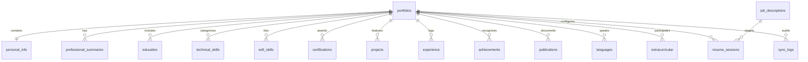

# Project Documentation: AI-Powered Portfolio Manager & Dynamic Resume Builder

**Application Name:** PortfolioForge  
**Author / Candidate:** Hazel Lakshmana  
**Degree:** Bachelor of Computer Science Engineering  
**Institution:** ITM Skills University, Navi Mumbai, Maharashtra  
**Academic Standing:** CGPA 9.3 / 10.0  
**Repository:** [https://github.com/hazelnutbytes/ai-portfolio-resume-builder](https://github.com/hazelnutbytes/ai-portfolio-resume-builder)  
**Synchronized Google Sheet:** [Live Google Sheet](https://docs.google.com/spreadsheets/d/1HSH4qsBJLFfA4AwDSJsxq3Z8pKTmyz37H-8nJbWabK0/edit)  

---

## 1. Executive Summary

In today’s competitive tech job market, candidates often struggle with two major challenges: maintaining an organized, single source of truth for their evolving academic and technical achievements, and rapidly tailoring their resumes for varied job profiles (e.g., Full-Stack Engineering vs. Frontend Development) without resorting to misleading exaggerations or tedious manual reformatting.

**PortfolioForge** is an AI-powered, centralized portfolio management and resume generation system. Built with Python (Flask), SQLite, React 18, Google Gemini AI, Google Sheets API v4, and ReportLab, it offers:
1. **Centralized Database**: An ACID-compliant relational SQLite store for personal info, coursework, categorized technical skills, certifications, projects, and hackathon activities.
2. **Dual-Engine AI Intelligence**: Powered by Google Gemini 2.5 Flash (via official `google-genai` SDK) with an automatic deterministic rule-based fallback that audits every claim against verified database IDs—guaranteeing **zero hallucinations**.
3. **Idempotent Google Sheets Synchronization**: Automated multi-tab synchronization with Google Sheets API v4 using a backend service account, updating existing records and logging every sync transaction.
4. **Dynamic ATS Resume Generator**: An interactive drag-and-drop resume builder that produces pixel-perfect, ATS-scannable PDFs via ReportLab with multiple layouts (Classic ATS and Modern Minimal).
5. **One Master Profile, Multiple Tailored Resumes**: Generates role-specific resumes customized to distinct Job Descriptions (JDs) from identical underlying student records.

---

## 2. Problem Statement & Functional Requirements

### 2.1 Problem Statement
College students and early-career developers accumulate fragmented records across GitHub, LinkedIn, hackathon submissions, and notes. When applying for distinct roles, they either send generic resumes that fail Applicant Tracking Systems (ATS) or use AI tools that hallucinate unearned skills or years of experience. 

The goal of this project is to create an auditable, centralized portfolio system where:
- All accomplishments are stored in a structured relational database.
- AI parses job descriptions and matches candidate credentials citing exact database IDs.
- Qualifications gaps (e.g. senior experience requirements) are surfaced honestly.
- The portfolio is exportable to Google Sheets as a living spreadsheet.
- Job-specific, ATS-compliant PDF resumes can be generated and customized in real time.

### 2.2 Functional Requirements Matrix

| Requirement | Implementation Module | Status |
|---|---|---|
| **1. Centralized Portfolio DB** | SQLite3 schema with 14 normalized tables, CRUD API, and seeding engine | **Complete** |
| **2. Gemini AI Integration** | Feature 3A (organize unstructured text), 3B (JD keyword extraction), 3C (evidence matching), 3D (fact-preserving rewrites) | **Complete** |
| **3. Google Sheets Integration** | Service Account v4 integration, 5 categorized tabs, idempotence, "Sheet1" removal, sync audit logs | **Complete** |
| **4. Dynamic Resume Generator** | Section reordering, item selection toggles, live side-by-side preview, dual template engine | **Complete** |
| **5. PDF Export** | ReportLab flowable PDF compiler with standard ATS fonts, margin budgeting, and dynamic naming | **Complete** |
| **6. User Interface** | Responsive React 18 SPA with Tailwind CSS, Lucide icons, and modal workflows | **Complete** |

---

## 3. System Architecture & Component Design

### 3.1 High-Level Architecture



### 3.2 Technology Stack Justification

- **React 18 & Vite:** Delivers ultra-responsive state management for real-time resume previews, drag-and-drop section ordering, and instant checkbox filtering without page reloads.
- **Python Flask 3.1:** Lightweight, modular micro-framework providing fast JSON endpoints, clean separation of concerns, and native interoperability with Google SDKs and ReportLab.
- **SQLite 3:** Serverless, zero-configuration relational database with full ACID compliance, foreign key cascades, and direct portability for demonstration and evaluation.
- **Google GenAI SDK (`google-genai`):** Official Google SDK leveraging `gemini-2.5-flash` for high-throughput, low-latency structured JSON generation and natural language analysis.
- **ReportLab 5.1:** Programmatic PDF generation engine that generates strict ATS-compliant PDFs with searchable text vectors, rather than lossy HTML-to-image or canvas screenshots.
- **Google Sheets API v4:** Enterprise service-account-based cloud synchronization providing bidirectional audit trails and idempotent cell updates.

---

## 4. Database Design & Schema

The relational schema is defined in `backend/database/schema.sql` and includes 14 normalized tables:



### 4.1 Schema Tables Summary

1. `portfolios`: Master anchor table holding candidate slug, title, and timestamps.
2. `personal_info`: Candidate identity (full name, target title, email, phone, location, LinkedIn, GitHub).
3. `professional_summaries`: Role-specific summary variants (e.g. Full-Stack focus vs. Frontend focus).
4. `education`: Degree, institution, start/end dates, CGPA (9.3/10.0), coursework.
5. `technical_skills`: Skills classified by category (Languages, Frameworks, Databases, Tools) and proficiency (Basic, Intermediate).
6. `soft_skills`: Interpersonal and collaborative competencies.
7. `certifications`: Professional courses with issuing organization, date, credential ID, and URL.
8. `projects`: Project title, role, tech stack (comma-delimited), start/end dates, project URL, GitHub URL, bullet points.
9. `experience`: Internships and work history (empty for 2nd-year student profile).
10. `achievements`: Honors and awards (empty for 2nd-year student profile).
11. `publications`: Academic papers and research articles.
12. `languages`: Natural languages spoken and proficiency levels.
13. `extracurricular`: Hackathons, clubs, volunteering, and leadership roles.
14. `job_descriptions`: Target job descriptions analyzed with extracted requirements and keywords.
15. `resume_sessions`: Saved resume configurations mapping a portfolio and JD to selected section orders and item IDs.
16. `sync_logs`: Audit trail for every Google Sheets synchronization event.

---

## 5. Gemini AI Integration & Fact-Preservation Engine

### 5.1 Dual-Engine Strategy
To ensure the application is 100% dependable even without internet access or when an API key is unconfigured, PortfolioForge implements a dual-engine architecture:
- **Primary Engine:** Google Gemini 2.5 Flash via `google-genai` SDK using structured JSON schema prompts.
- **Secondary Fallback:** Deterministic rule-based extraction engine employing boundary regexes, stopword filtering, and synonym maps.

### 5.2 Four Core AI Capabilities

#### Capability 3A: Unstructured Text Parsing & Portfolio Organization
- **Goal:** Allow the user to paste unstructured text (e.g., notes, rough resumes, LinkedIn profiles).
- **Process:** Gemini categorizes content into education, skills, projects, and certifications.
- **Safety Mechanism:** The extracted records are returned to a front-end **Review Modal**. The user inspects and edits each item before confirming insertion into the SQLite database.

#### Capability 3B: Job Description Analysis
- **Goal:** Extract requirements from pasted job descriptions.
- **Process:** Deconstructs the job description into:
  - Technical skills (required vs. preferred)
  - Soft skills
  - Required education and experience thresholds (e.g., "5+ years", "Bachelor's degree")
  - Responsibilities and domain keywords.

#### Capability 3C: Evidence-Audited Matching & Gap Detection
- **Strict Non-Fabrication Guarantee:** The matcher compares each JD requirement against existing SQLite records.
- **Verification Rule:** A requirement is marked as `matched: true` **only if** a corresponding record exists in SQLite. Every match explicitly cites supporting record IDs and titles (e.g., `"Matches Project #1: Hospital Management System"`).
- **Honest Gap Detection:** If a job requires "5+ years of production experience" or "Kubernetes/AWS", the engine flags it as a qualification gap rather than inventing experience.

#### Capability 3D: Fact-Preserving Resume Wording Suggestions
- **Goal:** Optimize bullet points and summaries for clarity and ATS keyword density.
- **Rule:** The prompt enforces strict constraint adherence:
  > *"You must not add unearned achievements, alter technical skills, or invent job roles. Improve conciseness and action verbs based exclusively on the provided context."*

---

## 6. Google Sheets API Integration

### 6.1 Authentication & Configuration
- Uses a Google Cloud Service Account with domain-wide or direct sheet editor delegation.
- Reads `GOOGLE_SERVICE_ACCOUNT_FILE` (`backend/service_account.json`) and `GOOGLE_SPREADSHEET_ID`.
- Scopes: `https://www.googleapis.com/auth/spreadsheets`.

### 6.2 Synchronization Architecture
- **Idempotence:** The system queries existing tabs and inspects the header row. Rows are matched by `Record ID` to prevent duplicate appends on repeated sync calls.
- **Clean Structure:** The service deletes the default empty `Sheet1` and eliminates empty category tabs, leaving exactly 5 clean, populated tabs:
  1. `Personal Information`
  2. `Education`
  3. `Technical Skills`
  4. `Projects`
  5. `Certifications`
- **Audit Logging:** Every sync operation writes a record to the `sync_logs` table with timestamp, status (`success` or `failed`), record count, and error message (if any).

---

## 7. Dynamic ATS-Compliant Resume Generation

### 7.1 ReportLab PDF Compiler
The PDF generation engine ([`backend/services/pdf_service.py`](file:///Users/macbook/Downloads/portfolio_web_app/backend/services/pdf_service.py)) builds resumes programmatically using ReportLab Platypus:
- Uses standard ATS-safe fonts (Helvetica, Times-Roman).
- Employs exact line-height and margin budgeting (0.5-inch margins) to prevent accidental overflow.
- Generates clean, searchable vector text that ATS parsers (Workday, Greenhouse, Taleo) read effortlessly.
- Filename formatting: `Hazel_Lakshmana_<Role>_Resume.pdf`.

### 7.2 Two ATS Resume Templates
1. **Classic ATS Template:**
   - Centered header with contact links.
   - Clean horizontal divider rules (`#CCCCCC`).
   - Standard serif/sans balance with compact margins.
2. **Modern Minimal Template:**
   - Left-aligned header with a professional slate/navy accent (`#1E293B`).
   - Clean category badges and indented project bullet points.

### 7.3 Case Study: Two Tailored Resumes from the Same Portfolio

| Parameter | Resume 1: Full-Stack Developer | Resume 2: Frontend & React.js Developer |
|---|---|---|
| **Target Role** | Full-Stack Web Developer | Frontend & React.js Developer |
| **Template** | Classic ATS | Modern Minimal |
| **Summary** | Emphasizes backend systems (Python, MySQL), REST APIs, and full-stack integration | Emphasizes UI performance, React.js, responsive layouts, and CSS keyframe animations |
| **Top Skills** | Python, MySQL, SQL, PostgreSQL, React.js, Git | React.js, JavaScript, HTML5, CSS3, Tailwind CSS, Git |
| **Primary Project** | *Hospital Management System* (Python/MySQL) placed first | *Red Bull Website Clone* (React/CSS Animations) placed first |
| **Secondary Project** | *Personal Portfolio Website* | *Personal Portfolio Website* |
| **Certifications** | HackerRank SQL (Intermediate), SQL (Basic), Java (Basic) | HackerRank Java (Basic), SQL (Basic) |

---

## 8. REST API Reference

| Method | Endpoint | Description |
|---|---|---|
| `GET` | `/api/health` | Service health status and timestamp |
| `GET` | `/api/portfolio` | Fetch entire master portfolio with all categories |
| `POST` | `/api/portfolio/reset` | Resets database to Hazel Lakshmana's seed profile |
| `POST` | `/api/portfolio/entries` | Add an entry to any portfolio category |
| `PUT` | `/api/portfolio/entries/:cat/:id` | Update an existing portfolio entry |
| `DELETE` | `/api/portfolio/entries/:cat/:id`| Delete an entry |
| `POST` | `/api/ai/organize` | Parse unstructured text into structured candidates |
| `POST` | `/api/ai/suggest` | Get fact-preserving wording suggestions |
| `POST` | `/api/jobs/analyze` | Analyze a Job Description and audit matches against SQLite |
| `GET` | `/api/resume/sessions` | List saved resume builder sessions |
| `POST` | `/api/resume/preview` | Preview resume data structure in real time |
| `POST` | `/api/resume/generate` | Compile and download ATS-compliant PDF resume |
| `POST` | `/api/sheets/sync` | Trigger idempotent Google Sheets synchronization |
| `GET` | `/api/sheets/logs` | Retrieve recent Google Sheets sync audit logs |
| `GET` | `/api/integrations/status` | Check Gemini and Google Sheets connectivity status |

---

## 9. Verification & Automated Testing

The application includes an automated test suite located at [`backend/tests/test_app.py`](file:///Users/macbook/Downloads/portfolio_web_app/backend/tests/test_app.py).

```bash
python backend/tests/test_app.py
```

### Test Results (8/8 Passed)
- `test_01_portfolio_endpoint`: Verifies master portfolio retrieval, candidate identity, and relational categories.
- `test_02_database_crud`: Validates addition, update, and deletion of a project record with foreign key consistency.
- `test_03_job_analyzer_fullstack`: Analyzes a Full-Stack Job Description, verifying matching against Hazel's Python/MySQL/React skills.
- `test_04_job_analyzer_gap_detection`: Tests a Senior Job Description requiring 5+ years experience and verifies that experience thresholds are flagged as unmatched gaps.
- `test_05_resume_preview`: Confirms dynamic session configuration, section reordering, and item selection.
- `test_06_pdf_generation_classic`: Generates Classic ATS PDF and verifies HTTP 200, PDF header bytes (`%PDF-`), and content length.
- `test_07_pdf_generation_modern`: Generates Modern Minimal PDF and verifies PDF headers.
- `test_08_gemini_service_fallback`: Confirms that the fallback parser operates seamlessly without crashing when an API key is missing.

---

## 10. Local Setup & Execution Guide

### Prerequisites
- Python 3.10 or higher
- Node.js 18 or higher with npm
- Git

### Step 1: Clone the Repository
```bash
git clone https://github.com/hazelnutbytes/ai-portfolio-resume-builder.git
cd ai-portfolio-resume-builder
```

### Step 2: Backend Setup
```bash
cd backend
python3 -m venv venv
source venv/bin/activate
pip install -r requirements.txt
python database/seed.py
python app.py
```
*Backend runs on `http://127.0.0.1:5001`.*

### Step 3: Frontend Setup
In a new terminal:
```bash
cd frontend
npm install
npm run dev
```
*Frontend runs on `http://localhost:5173`.*

### Step 4: Environment Configuration (Optional)
Copy `.env.example` to `.env`:
```bash
cp .env.example .env
```
Populate optional keys:
- `GEMINI_API_KEY`: Google AI Studio Gemini API Key.
- `GOOGLE_SPREADSHEET_ID`: Target Google Sheets document ID.
- `GOOGLE_SERVICE_ACCOUNT_FILE`: Path to Service Account JSON key.

---

## 11. Submission Deliverables Summary

1. **Source Code:** [https://github.com/hazelnutbytes/ai-portfolio-resume-builder](https://github.com/hazelnutbytes/ai-portfolio-resume-builder)
2. **Live Google Sheet:** [https://docs.google.com/spreadsheets/d/1HSH4qsBJLFfA4AwDSJsxq3Z8pKTmyz37H-8nJbWabK0/edit](https://docs.google.com/spreadsheets/d/1HSH4qsBJLFfA4AwDSJsxq3Z8pKTmyz37H-8nJbWabK0/edit)
3. **Database Schema:** Defined in `backend/database/schema.sql` (14 relational tables).
4. **PDF Generator:** ReportLab compiler with Classic and Modern ATS templates.
5. **Demonstration Profiles:** Seeded with Hazel Lakshmana's verified 2nd-year CS student records (ITM Skills University, 9.3 CGPA, HackerRank Certifications, Hackathon experience).
